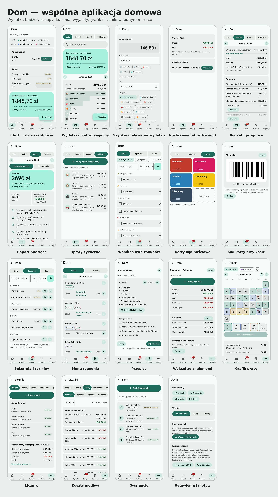

# Dom — wspólna aplikacja domowa

Jedna aplikacja na telefon (PWA, Android) dla dwóch osób prowadzących wspólny dom: wydatki z rozliczaniem jak w Tricount, budżet wspólnego konta, lista zakupów, karty lojalnościowe, przepisy i menu, wyjazdy ze znajomymi, grafik pracy i liczniki mediów.

Działa za darmo na **Supabase** (baza, logowanie, zdjęcia) i **Vercel** (hosting, powiadomienia). Interfejs po polsku, wygląd Material 3 Expressive, jasny i ciemny motyw.



> Dane na zrzutach są przykładowe.

## Funkcje

- **Wydatki**: konto wspólne lub prywatne, kategorie, podział po równo / częściami / kwotami, zdjęcie paragonu, rozliczenie minimalną liczbą przelewów, wyszukiwarka, działanie bez internetu
- **Budżet**: limit miesięczny konta wspólnego, saldo konta, prognoza do końca miesiąca, opłaty cykliczne z przypomnieniami, raport miesiąca
- **Import z banku**: wyciąg CSV z Millennium. Plik jest czytany tylko w telefonie, do bazy trafiają wybrane transakcje, bez numerów kont
- **Zakupy**: wspólna lista na żywo, jednostki, osobne listy (np. IKEA, Internet), spiżarnia z terminami ważności
- **Karty lojalnościowe**: kod kreskowy / QR, skan aparatem albo ze zrzutu ekranu
- **Kuchnia**: przepisy (także import z adresu strony), menu tygodnia, składniki na listę zakupów
- **Wyjazdy**: wspólne koszty z gośćmi bez konta, link tylko do odczytu dla znajomych
- **Grafik**: osobny grafik każdej osoby, zapis do Kalendarza Google, podgląd grafiku drugiej osoby
- **Liczniki**: odczyty prądu, wody i CO, taryfy, koszty i rozliczenia, eksport do Excela
- **Gwarancje**, **powiadomienia push**, **kopia zapasowa** (JSON)

## Uruchomienie własnej kopii

### 1. Supabase (baza)

1. Załóż darmowy projekt na [supabase.com](https://supabase.com).
2. **SQL Editor → New query**: wklej i uruchom **po kolei** każdy plik:
   1. `schema-liczniki.sql` (gospodarstwo domowe, członkowie, liczniki)
   2. `schema-dom.sql` (wydatki, wyjazdy, zdjęcia paragonów)
   3. `schema-zakupy.sql`
   4. `schema-kuchnia.sql`
   5. `schema-budzet.sql`
   6. `schema-dodatki.sql`
   7. `schema-import.sql`
   8. `schema-powiadomienia.sql`
   9. `schema-grafik.sql`
3. **Project Settings → API Keys**: skopiuj adres projektu i klucz **publishable** (anon).

### 2. Kod i hosting

1. Zrób **fork** tego repozytorium (albo pobierz ZIP i wrzuć do własnego repo).
2. W `config.js` wpisz adres i klucz publishable z Supabase.
3. [vercel.com](https://vercel.com) → **Add New → Project** → wybierz repozytorium.
   W **Environment Variables** dodaj `SUPABASE_URL` i `SUPABASE_ANON_KEY` (te same, co w `config.js`). Potrzebuje ich import przepisów, żeby wpuszczać tylko zalogowanych → **Deploy**.
4. **Zalecane:** w `vercel.json`, w nagłówku `Content-Security-Policy`, zamień `*.supabase.co` na adres swojego projektu (np. `abcd1234.supabase.co`). Wtedy aplikacja może wysyłać dane wyłącznie do Twojej bazy.
5. Na telefonie otwórz adres aplikacji w Chrome → menu → **Zainstaluj aplikację**.

### 3. Konta

1. Obie osoby zakładają konto w aplikacji (e-mail i hasło).
2. Pierwsza osoba tworzy dom, druga dołącza **kodem zaproszenia** (Więcej → Dom).
3. **Ważne:** potem wyłącz rejestrację: Supabase → Authentication → Sign In / Providers → *Allow new users to sign up* → **off**.

### 4. Powiadomienia (opcjonalnie)

1. Wygeneruj klucze: `npx web-push generate-vapid-keys`.
2. Klucz **publiczny** wpisz do `config.js` (`VAPID_PUBLIC_KEY`).
3. Vercel → Settings → **Environment Variables**:
   - `VAPID_PUBLIC_KEY`, `VAPID_PRIVATE_KEY`, `VAPID_SUBJECT` (np. `mailto:ty@example.com`)
   - `SUPABASE_URL`
   - `SUPABASE_SERVICE_KEY` (Supabase → API Keys → *secret*)
   - `WEBHOOK_SECRET` i `CRON_SECRET` (długie losowe ciągi, min. 20 znaków; **bez nich powiadomienia nie ruszą**)

   Potem **Redeploy**.
4. Skopiuj `push-trigger.example.sql` **poza repozytorium**, wpisz adres aplikacji i `WEBHOOK_SECRET`, uruchom w Supabase.

Codzienne przypomnienia (opłaty, gwarancje, spiżarnia, liczniki) wysyła cron Vercela (`vercel.json`).

### 5. Grafik → Kalendarz Google (opcjonalnie)

Bez tego kroku grafik działa normalnie, tylko w aplikacji. Żeby przycisk „Zapisz” wysyłał zmiany do Kalendarza Google:

1. [script.google.com](https://script.google.com) → **Nowy projekt** → wklej `apps-script/Code.gs`.
2. Ustawienia projektu → zaznacz „Pokaż plik manifestu” → wklej treść `apps-script/appsscript.json`.
3. Ustawienia projektu → **Właściwości skryptu** → dodaj `API_KEY` = długi losowy ciąg (30+ znaków).
4. **Wdróż → Nowe wdrożenie → Aplikacja internetowa**: *Wykonaj jako*: Ja, *Kto ma dostęp*: Każdy → autoryzuj → skopiuj adres `/exec`.
5. W Dom: Grafik → ustawienia → wklej adres i klucz → **Testuj połączenie** → **Pobierz kalendarze** → wybierz ID kalendarza dla każdej osoby.
6. Kalendarz drugiej osoby musi być udostępniony osobie, która wdrożyła skrypt, z prawem **„Wprowadzanie zmian w wydarzeniach”**.

Skrypt nie ma w kodzie żadnych ID kalendarzy, bo dostaje je z aplikacji. Zmienia tylko wydarzenia, które sam utworzył, albo te, których tytuł pasuje do kategorii grafiku. Inne wydarzenia w kalendarzu zostają nietknięte. Po zmianie `Code.gs`: Wdróż → Zarządzaj wdrożeniami → edytuj → Wersja: **Nowa** (adres zostaje ten sam).

## Bezpieczeństwo

**Co chroni dane**
- **RLS w bazie**: każdy widzi wyłącznie dane swojego domu. Klucz publishable w `config.js` jest publiczny z założenia i bez zalogowania nic nie odczyta.
- **Nagłówki (`vercel.json`)**: Content-Security-Policy pozwala uruchamiać tylko skrypty z aplikacji i wysyłać dane tylko do Supabase (oraz Apps Script dla grafiku). Wstrzyknięty skrypt nie wyśle danych na obcy serwer. Do tego: brak osadzania w ramkach (`frame-ancestors 'none'`), `Referrer-Policy: no-referrer`, HSTS, `nosniff`, aparat tylko dla aplikacji.
- **Brak zasobów z zewnątrz**: biblioteki i font są w repozytorium (bez CDN). Zdjęcia importowanych przepisów kopiują się do Twojego Supabase, więc cudze strony nie widzą, kiedy otwierasz przepis.
- **Funkcje serwera**: `api/przepis` przyjmuje tylko zalogowanych (token sesji) i nie łączy się z adresami prywatnymi ani lokalnymi, także po przekierowaniu. `api/push` bez ustawionych sekretów odrzuca każde wywołanie.
- **Telefon**: wylogowanie usuwa kopię offline, kolejki i zdjęcia czekające na wysłanie oraz wyłącza powiadomienia na tym urządzeniu. Link do podglądu wyjazdu trzyma token po `#`, więc nie trafia do logów serwera.
- **Zdjęcia paragonów**: prywatny bucket, dostęp tylko dla członków domu przez linki ważne godzinę.
- **Wyciąg z banku** nie opuszcza telefonu.

**Sekrety** (`secret` / `service_role`, prywatny klucz VAPID, `WEBHOOK_SECRET`, `CRON_SECRET`, `API_KEY` skryptu) trzymaj **tylko** w zmiennych Vercela albo właściwościach Apps Script. Nigdy w plikach repozytorium.

**Lista kontrolna Supabase**
- Authentication → *Allow new users to sign up* → **off** (po założeniu kont).
- Authentication → Passwords: minimum 10–12 znaków; *leaked password protection*, jeśli dostępna.
- Database → Settings: **Enforce SSL**.
- Sprawdzenie RLS (pusty wynik = dobrze):
  ```sql
  select tablename from pg_tables where schemaname = 'public' and not rowsecurity;
  ```

Znalazłeś problem z bezpieczeństwem? Zgłoś go prywatnie (GitHub → *Security → Report a vulnerability*), nie w publicznym Issue.

## Technologia

Czysty JavaScript (moduły ES), bez frameworka i bez kroku budowania. Wszystkie pliki leżą w jednym folderze. Supabase (Postgres, Auth, Realtime, Storage), funkcje Vercela (`api/`), Service Worker z kolejką offline. System wyglądu opisuje [`DESIGN.md`](DESIGN.md), a tokeny są w `tokens.css`.

Biblioteki zewnętrzne: [`THIRD-PARTY.md`](THIRD-PARTY.md). Licencja: [MIT](LICENSE).
